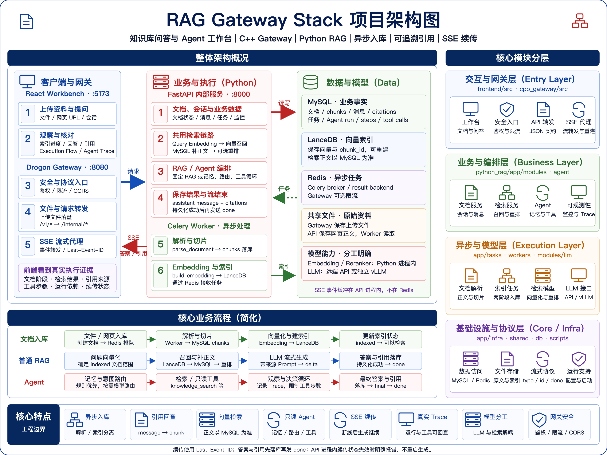

# RAG Gateway Stack

基于 C++ Drogon、FastAPI 和 React 的 RAG / Agent 工程栈，提供文档入库、知识库问答、来源引用、只读工具调用与执行链路观测。

项目覆盖从文件上传、异步解析和向量索引，到检索增强生成、消息持久化和流式交互的完整流程。C++ 网关负责对外协议与流量控制，Python 服务负责 RAG 与 Agent 业务，前端工作台展示文档状态、回答证据和执行轨迹。

适用于本地知识库原型、RAG / Agent 工程实践、检索与模型接入验证，以及系统架构演示。当前以本地开发和工程验证为主要目标。

[快速开始](#快速开始) · [系统架构](#系统架构) · [API 概览](#api-概览) · [技术文档](docs/README.md)

## 核心能力

| 能力 | 说明 |
| --- | --- |
| 文档入库 | 支持 Markdown、TXT、JSON、CSV、PDF、DOCX、XLSX 与网页 URL；通过 Celery 异步完成解析、切片、向量化和索引 |
| 知识库问答 | LanceDB 向量召回、MySQL 正文补齐、可选 CrossEncoder 重排；支持指定文档范围 |
| 引用追溯 | 保存回答与 citations，关联原始文档和 chunk，支持历史消息引用回查 |
| 只读 Agent | 结合意图路由、会话摘要、最近消息和用户记忆，执行有步数上限的工具循环 |
| SSE 续传 | 使用递增事件 ID 和 `Last-Event-ID` 恢复；客户端断开后生成继续，答案与引用落库后发送 `done` |
| 执行观测 | 展示文档索引阶段、Execution Flow、Agent Trace、任务状态与运行监控 |
| 网关控制 | 提供 CORS、可配置 API Key 鉴权、Redis 限流、活跃流数量限制与健康检查 |
| 模型接入 | 支持远端 OpenAI-compatible API 或独立本地 vLLM；Embedding 与 Reranker 单独配置 |

## 工作台预览


工作台将文档管理、知识库问答和链路诊断放在同一界面：查看文档入库进度，跟踪工具调用与检索结果，阅读回答及其来源，并检查服务依赖状态。

## 系统架构



| 层级 | 组件 | 职责 |
| --- | --- | --- |
| 交互层 | React + TypeScript + Vite | 文档管理、问答、引用展示、执行轨迹与监控 |
| 网关层 | C++17 + Drogon + libcurl | 对外 `/v1/*` API、文件上传、鉴权、限流、健康聚合与 SSE 代理 |
| 业务层 | Python + FastAPI | 内部 `/internal/*` API、检索、Prompt、Chat、Agent 与监控业务 |
| 异步执行 | Celery + Redis | 文档解析、向量化、索引构建与非流式 Chat 任务 |
| 结构化存储 | MySQL | 用户、文档、chunk、会话、消息、citations、任务与 Agent Trace |
| 向量存储 | LanceDB | chunk 向量索引与召回元数据 |
| 检索模型 | sentence-transformers | Embedding 与 CrossEncoder 重排 |
| 生成模型 | OpenAI-compatible API / vLLM | 回答生成与 Agent 模型调用 |

浏览器通过 Gateway 访问业务服务。FastAPI 与 Worker 共用业务模块，分别承担在线请求与异步任务。MySQL 是结构化业务数据的事实来源；LanceDB 保存可重建的向量索引，召回后从 MySQL 读取 chunk 正文；Redis 用于任务分发、结果缓存和网关限流。

完整组件关系与代码入口见 [架构概览](docs/architecture.md)。

### 核心流程

**文档入库**

```text
文件上传 / 网页导入 -> 创建文档 -> Celery 解析与切片
                    -> MySQL 保存 chunks -> Embedding -> LanceDB 索引
```

解析与向量化分为两个异步任务，前端通过文档和任务接口查询阶段与失败信息。

**普通 RAG 问答**

```text
用户问题 -> Query Embedding -> LanceDB 召回 -> MySQL 补齐正文
         -> 可选重排 -> Prompt 组装 -> LLM 生成 -> 保存回答与 citations
```

默认检索已完成索引的可用文档；传入 `doc_id` / `doc_ids` 后限制检索范围。检索结果保留召回分数、重排分数和排名信息，便于定位证据来源与排序变化。

**Agent 问答**

```text
问题与会话记忆 -> 意图路由 -> 模型决策 / 知识库检索
               -> 只读工具循环 -> 最终回答 -> 保存消息、引用与 Trace
```

意图路由先匹配明确规则，再由模型判断歧义问题。需要知识库证据时先执行检索，普通问候和纯元数据查询进入相应 Agent 分支。

内置工具包括：

| 工具 | 用途 |
| --- | --- |
| `knowledge_search` | 检索知识库，返回 chunk、分数和来源元数据 |
| `get_document_detail` | 查询文档状态、元数据与 chunk 摘要 |
| `list_ready_documents` | 列出已完成索引的文档 |
| `list_message_citations` | 查询历史回答的已保存引用 |

普通 RAG 在生成过程中逐步发送回答 `delta`；当前 Agent 实时发送执行事件，最终回答完成并持久化后再发送答案 `delta`、`final` 和 `done`。

<a id="如何在本地启动"></a>

## 快速开始

以下命令均从仓库根目录执行。

### 1. 环境要求

- Linux、Bash 和 Python 3.10+，可使用 Conda 或项目内虚拟环境。
- Node.js 与 npm，用于安装和构建前端。
- C++17 编译器、CMake 3.16+、Drogon、libcurl，以及 Drogon 所需的 JsonCpp 等依赖；Drogon 必须启用 MySQL 与 Redis 支持。
- 可访问的 MySQL、Redis 服务，以及 MySQL 命令行客户端。
- 可用的生成模型服务；Embedding 与 Reranker 可使用本地模型路径或模型缓存，支持 CPU 运行。

依赖安装、Drogon 构建与环境排障见 [运行环境说明](docs/environment.md)。

### 2. 安装项目依赖

```bash
conda create -n rag-api python=3.10
conda activate rag-api
python -m pip install -r python_rag/requirements.txt
python -m pip install -r python_rag/requirements-dev.txt

(cd frontend && npm install)
```

也可使用项目内 `.venv`，启动脚本支持通过 `RAG_API_VENV` 指定环境路径。

### 3. 配置服务与模型

首次运行且尚无 `.env` 时，复制配置模板：

```bash
cp .env.example .env
```

按实际环境填写 MySQL、Redis 和模型连接信息。关键配置如下，完整变量见 [.env.example](.env.example)：

| 配置 | 作用 |
| --- | --- |
| `MYSQL_*` | 数据库地址、库名与访问凭据 |
| `REDIS_*`、`CELERY_BROKER_URL`、`CELERY_RESULT_BACKEND` | Redis 连接、任务队列与结果存储；启用认证时保持各连接一致 |
| `LLM_BASE_URL`、`LLM_API_KEY`、`LLM_MODEL` | 生成模型服务地址、凭据与模型名称 |
| `EMBEDDING_MODEL`、`EMBEDDING_DEVICE` | Embedding 模型与运行设备 |
| `RERANK_MODEL`、`RERANK_ENABLE`、`RERANK_DEVICE` | 重排模型、开关与运行设备 |
| `LANCEDB_PATH`、`UPLOAD_DIR` | 向量索引与上传文件目录 |
| `GATEWAY_AUTH_ENABLED`、`GATEWAY_API_KEYS` | 网关 API Key 鉴权 |

默认使用远端 OpenAI-compatible API，检索模型默认配置为 `Qwen/Qwen3-Embedding-0.6B` 与 `Qwen/Qwen3-Reranker-0.6B`。运行前需准备模型文件或确保模型来源可访问。切换 Embedding 模型后，应重建已有向量索引。

Python 检索模型使用 CPU 时设置 `PYTHON_DISABLE_CUDA=true`；使用本机 GPU 时可设置 `PYTHON_CUDA_VISIBLE_DEVICES=4,5`，或用 `API_CUDA_VISIBLE_DEVICES`、`WORKER_CUDA_VISIBLE_DEVICES` 分别控制两个进程。

本地 vLLM 需要单独的 Python 环境与模型路径，配置和启动方式见 [本地模型说明](docs/environment.md#配置分三层理解)。统一启动脚本不启动 vLLM。

### 4. 初始化数据库并启动

确认 MySQL 与 Redis 已运行后执行：

```bash
bash scripts/init_db.sh
START_FRONTEND=true bash scripts/start_all.sh start
```

初始化脚本创建数据库并执行初始化与升级 SQL；数据库账号需具备对应权限，必要时配置 `MYSQL_ADMIN_USER` / `MYSQL_ADMIN_PASSWORD`。

Gateway 二进制不存在时，启动脚本会自动执行 CMake 构建；需要手动构建时运行：

```bash
cmake -S cpp_gateway -B cpp_gateway/build -DCMAKE_BUILD_TYPE=Debug
cmake --build cpp_gateway/build -j
```

启动后默认访问地址：

| 服务 | 地址 |
| --- | --- |
| 前端工作台 | `http://127.0.0.1:5173` |
| Gateway | `http://127.0.0.1:8080` |
| FastAPI 内部服务 | `http://127.0.0.1:8000` |

### 5. 验证与体验

```bash
bash scripts/start_all.sh status
curl http://127.0.0.1:8080/health
curl http://127.0.0.1:8000/internal/health
```

在工作台选择或创建用户，上传文档并等待索引完成，然后发起问题，查看回答引用与执行轨迹。示例问题与验收步骤见 [演示案例](docs/demo_cases.md)。启用网关鉴权后，API 请求需携带对应 API Key；配置方式见 [鉴权与限流](docs/gateway_auth_rate_limit.md)。

## 服务管理与验证

| 命令 | 用途 |
| --- | --- |
| `bash scripts/start_all.sh start` | 启动 API、Worker 与 Gateway |
| `START_FRONTEND=true bash scripts/start_all.sh start` | 同时启动前端工作台 |
| `bash scripts/start_all.sh restart api` | 重启 FastAPI |
| `bash scripts/start_all.sh status` | 检查进程与 HTTP 状态 |
| `bash scripts/start_all.sh logs worker` | 查看 Worker 日志 |
| `bash scripts/start_all.sh stop` | 停止由脚本管理的服务 |

PID 文件位于 `.run/`，运行日志位于 `logs/`。完整参数与单进程调试入口见 [脚本说明](scripts/README.md)。

代码检查与回归测试：

```bash
python -m pytest
python -m compileall python_rag tests
bash scripts/ci_smoke.sh
```

`ci_smoke.sh` 包含 Python 编译检查、pytest、Shell 语法检查和前端构建（npm 可用时）。完整链路验证需要已启动的服务：

```bash
bash scripts/e2e_all.sh ./README.md
```

E2E 会创建真实的用户、文档、任务和消息记录。

## API 概览

客户端统一访问 Gateway `/v1/*`；FastAPI `/internal/*` 用于服务间调用与内部调试。

| 方法 | 路径 | 用途 |
| --- | --- | --- |
| `POST` | `/v1/documents` | 上传文档并提交入库任务 |
| `POST` | `/v1/documents/web` | 导入网页并提交入库任务 |
| `GET` | `/v1/documents` | 查询文档与索引状态 |
| `POST` | `/v1/sessions` | 创建会话 |
| `POST` | `/v1/sessions/{id}/messages` | 提交非流式问答任务 |
| `GET` | `/v1/sessions/{id}/messages` | 查询消息与 citations |
| `POST` | `/v1/chat/stream` | 普通 RAG SSE 问答 |
| `POST` | `/v1/agent/chat/stream` | Agent 问答与执行事件 |
| `GET` | `/v1/tasks/{task_id}` | 查询异步任务状态 |
| `GET` | `/v1/monitor/overview` | 查询运行与 RAG 指标 |

非 SSE API 的成功与错误响应统一使用 `{code, message, data}`：

```json
{
  "code": 0,
  "message": "ok",
  "data": {}
}
```

SSE 数据包含 `type`，事件 ID 单调递增，最终以 `done` 或 `error` 结束。续传需携带同一次运行的标识与 `Last-Event-ID`：普通 Chat 使用 `user_message_id`，Agent 使用 `trace_id`。生成在客户端断开后继续执行；服务端先保存最终消息与 citations，再发出 `done`。续传状态失效时明确返回错误，不重新启动生成。

请求参数、事件结构、错误码与续传示例见 [API 契约](docs/api_agent.md)。

## 项目结构

```text
.
├── cpp_gateway/      # C++ Drogon 网关与 SSE 代理
├── python_rag/       # FastAPI、RAG、Agent 与 Celery
│   └── app/
│       ├── api/      # HTTP 路由与参数处理
│       ├── agent/    # 路由决策、工具循环、记忆、Trace 与流式传输
│       ├── modules/  # 文档、入库、检索、Chat、任务与监控业务
│       ├── workers/  # Celery 应用与任务入口
│       ├── infra/    # 数据库、Redis 与文件存储
│       ├── core/     # 配置、日志与错误处理
│       └── shared/   # 通用传输与数据工具
├── frontend/         # React + TypeScript 工作台
├── db/               # MySQL 初始化与升级 SQL
├── scripts/          # 启动、验证与性能测试入口
├── tests/            # Python 回归测试
├── docs/             # 架构、接口、运行与实验文档
└── data/             # 上传文件与本地索引
```

路由保持轻量，可复用业务逻辑集中在 `modules`，Agent 编排位于 `agent`，基础设施访问位于 `infra`。

## 当前边界

- **部署范围**：面向本地开发、演示和工程验证，多租户隔离、生产级密钥管理与部署编排仍需补充。
- **SSE 状态**：事件缓存保存在 API 进程内，完成流默认保留 15 分钟，并受数量上限约束。API 重启、缓存淘汰或续传请求落到其他进程会导致恢复失败；多进程部署需保证续传回到原进程。
- **并发模型**：Gateway 的 SSE 代理仍按活跃流占用受限数量的 OS 线程，高并发场景需要进一步评估与改造。
- **引用粒度**：citations 关联消息、文档与 chunk，当前未提供完整的逐句证据 span。
- **观测粒度**：部分检索阶段随工具结果聚合返回；界面展示实际事件，不代表每个内部步骤都有独立实时耗时。

## 技术文档

| 主题 | 文档 |
| --- | --- |
| 文档索引 | [完整文档导航](docs/README.md) |
| 系统架构 | [架构概览](docs/architecture.md) · [数据库关系](docs/数据库关系.md) |
| 本地运行 | [环境与排障](docs/environment.md) · [启动脚本](scripts/README.md) |
| Agent 与接口 | [Agent 设计](docs/agent_mvp.md) · [API 契约](docs/api_agent.md) |
| 网关安全 | [鉴权与限流](docs/gateway_auth_rate_limit.md) |
| 检索与容量 | [Ingest / Retrieval 容量设计](docs/rag_ingest_retrieval_capacity.md) |
| 监控与性能 | [监控指标](docs/monitoring_metrics.md) · [性能测试指南](docs/performance_test_guide.md) |
| 演示与实验 | [演示案例](docs/demo_cases.md) · [Embedding 微调复盘](docs/embedding_finetune.md) |
