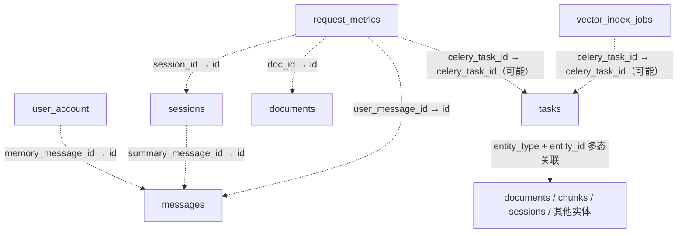

# 数据库关系

[返回文档地图](README.md)

本文展示 MySQL 业务表与 Agent Trace 的关系。基础表定义见 [db/init.sql](../db/init.sql)，Agent 表定义见 [db/004_create_agent_tables.sql](../db/004_create_agent_tables.sql)，已有库的字段与约束变化见 [db 目录](../db/)。图中的类型为简写，字段长度、默认值、索引和完整约束以 SQL 为准；本文不代表当前部署数据库已完成迁移。

## 按业务链路查表

| 链路 | 主要表 | 作用 |
| --- | --- | --- |
| 用户与会话 | `user_account`、`sessions` | 用户记忆、会话摘要与归属 |
| 文档入库 | `documents`、`doc_chunks`、`document_indexes`、`vector_index_jobs` | 文档与 chunk 正文、索引元数据、索引任务记录 |
| 问答与引用 | `messages`、`citations` | 用户问题、最终回答与来源 chunk |
| 异步任务 | `tasks` | Celery 任务状态、进度与错误 |
| Agent Trace | `agent_runs`、`agent_steps`、`agent_tool_calls` | 一次运行、决策步骤与工具调用 |
| 请求观测 | `request_metrics` | 延迟、用量、成本与检索统计 |

MySQL 保存业务事实与 chunk 正文；LanceDB 向量和 Redis 运行状态不在此关系图中，其职责见[架构概览](architecture.md)。

## 接口 ID 与数据库字段对照

| 接口或 Trace 字段 | 数据库字段 | 用途 |
| --- | --- | --- |
| `doc_id` / `document_id` | `documents.id` | 文档详情、索引任务与检索范围 |
| `chunk_id` | `doc_chunks.id` | 检索回表和 citation 来源；重新解析后可能变化 |
| `chunk_index` | `doc_chunks.chunk_index` | 文档内序号，需与 `doc_id` 一起定位 |
| `session_id` | `sessions.id` | 会话与消息归属 |
| `message_id` / `assistant_message_id` | `messages.id` | 根据上下文区分用户问题与最终回答；引用挂在 assistant message 上 |
| `task_id` / `embedding_task_id` | `tasks.celery_task_id` | Celery 字符串标识，用于 `/tasks/{task_id}` 查询 |
| `db_task_id` / `embedding_db_task_id` | `tasks.id` | 任务表的整数主键，不能当作 Celery task ID |
| `run_id` / `agent_run_id` | `agent_runs.id` | Agent 运行与 Trace 查询 |
| `step_id` | `agent_steps.id` | 某个执行步骤，配合 `run_id` 定位工具调用 |
| `trace_id` | `agent_runs.trace_id` | 调用方跟踪标识；SSE 在进程内结合 session 使用它识别同一次运行 |
| `event_id` / SSE `id` | 进程内事件缓冲 | 同一条流内的续传游标，不是上述表的主键 |

`trace_id` 当前只有普通索引，不是数据库唯一约束。消息、run 和 task 的 ID 属于不同实体，即使数值相同也不能互换。API 返回的 `meta` 通常来自表中的 `meta_json`，Trace 查询则保留 `input_json`、`output_json`、`meta_json` 等列名。

## 实体关系图

```mermaid
erDiagram
    USER_ACCOUNT {
        BIGINT id PK
        VARCHAR username UK
        TEXT memory_summary
        BIGINT memory_message_id
        TIMESTAMP memory_updated_at
        TIMESTAMP created_at
    }

    DOCUMENTS {
        BIGINT id PK
        BIGINT user_id FK "组合唯一键之一"
        VARCHAR filename
        VARCHAR mime
        CHAR sha256 "与 user_id 组合唯一"
        BIGINT size_bytes
        VARCHAR storage_path
        VARCHAR status
        VARCHAR index_status
        TEXT error_message
        TIMESTAMP created_at
        TIMESTAMP updated_at
    }

    DOC_CHUNKS {
        BIGINT id PK
        BIGINT doc_id FK "组合唯一键之一"
        INT chunk_index "与 doc_id 组合唯一"
        LONGTEXT text
        INT tokens_est
        VARCHAR embedding_status
        VARCHAR vector_index_status
        TIMESTAMP created_at
    }

    DOCUMENT_INDEXES {
        BIGINT id PK
        BIGINT doc_id FK,UK
        VARCHAR index_type
        VARCHAR embedding_model
        INT dimension
        VARCHAR index_path
        VARCHAR mapping_path
        INT chunk_count
        VARCHAR status
        TIMESTAMP created_at
        TIMESTAMP updated_at
    }

    VECTOR_INDEX_JOBS {
        BIGINT id PK
        BIGINT doc_id FK
        VARCHAR celery_task_id
        VARCHAR provider
        VARCHAR status
        INT chunk_count
        TEXT error_message
        JSON meta_json
        TIMESTAMP created_at
        TIMESTAMP updated_at
    }

    TASKS {
        BIGINT id PK
        VARCHAR celery_task_id UK
        VARCHAR type
        VARCHAR entity_type
        BIGINT entity_id
        VARCHAR state
        INT progress
        JSON meta_json
        TEXT error
        TIMESTAMP created_at
        TIMESTAMP updated_at
    }

    SESSIONS {
        BIGINT id PK
        BIGINT user_id FK
        VARCHAR title
        TEXT summary
        BIGINT summary_message_id
        TIMESTAMP created_at
        TIMESTAMP updated_at
    }

    MESSAGES {
        BIGINT id PK
        BIGINT session_id FK
        VARCHAR role
        LONGTEXT content
        VARCHAR status
        JSON meta_json
        TIMESTAMP created_at
        TIMESTAMP updated_at
    }

    CITATIONS {
        BIGINT id PK
        BIGINT message_id FK
        BIGINT doc_id FK
        BIGINT chunk_id FK
        INT chunk_index
        DOUBLE score
        TEXT snippet
        TIMESTAMP created_at
    }

    REQUEST_METRICS {
        BIGINT id PK
        VARCHAR request_type
        VARCHAR channel
        VARCHAR status
        BIGINT session_id
        BIGINT doc_id
        BIGINT user_message_id
        VARCHAR celery_task_id
        INT top_k
        INT ttft_ms
        INT e2e_latency_ms
        INT ready_latency_ms
        INT retrieval_ms
        INT prompt_tokens
        INT completion_tokens
        INT embedding_tokens
        DECIMAL cost_usd
        INT citation_count
        TINYINT no_context
        TINYINT timed_out
        VARCHAR context_mode
        VARCHAR answer_source
        TEXT error_message
        JSON extra_json
        TIMESTAMP created_at
    }

    AGENT_RUNS {
        BIGINT id PK
        VARCHAR trace_id
        VARCHAR agent_name
        VARCHAR agent_version
        VARCHAR model
        VARCHAR status
        BIGINT session_id FK
        BIGINT user_message_id FK
        JSON input_json
        JSON output_json
        JSON meta_json
        INT total_steps
        INT total_tool_calls
        INT prompt_tokens
        INT completion_tokens
        INT total_tokens
        DECIMAL cost_usd
        TEXT error_message
        TIMESTAMP started_at
        TIMESTAMP finished_at
        TIMESTAMP created_at
        TIMESTAMP updated_at
    }

    AGENT_STEPS {
        BIGINT id PK
        BIGINT run_id FK
        INT step_index
        VARCHAR step_type
        VARCHAR name
        VARCHAR status
        VARCHAR model
        JSON input_json
        TEXT reasoning_summary
        TEXT decision
        JSON output_json
        INT prompt_tokens
        INT completion_tokens
        INT total_tokens
        INT latency_ms
        TEXT error_message
        TIMESTAMP started_at
        TIMESTAMP finished_at
        TIMESTAMP created_at
        TIMESTAMP updated_at
    }

    AGENT_TOOL_CALLS {
        BIGINT id PK
        BIGINT run_id FK
        BIGINT step_id FK
        VARCHAR tool_call_id
        VARCHAR tool_name
        VARCHAR status
        JSON arguments_json
        JSON result_json
        TEXT result_preview
        INT latency_ms
        TEXT error_message
        TIMESTAMP started_at
        TIMESTAMP finished_at
        TIMESTAMP created_at
        TIMESTAMP updated_at
    }

    USER_ACCOUNT ||--o{ DOCUMENTS : "拥有 / CASCADE"
    USER_ACCOUNT ||--o{ SESSIONS : "创建 / CASCADE"

    DOCUMENTS ||--o{ DOC_CHUNKS : "拆分 / CASCADE"
    DOCUMENTS ||--o| DOCUMENT_INDEXES : "本地索引 / CASCADE"
    DOCUMENTS ||--o{ VECTOR_INDEX_JOBS : "索引任务 / CASCADE"
    DOCUMENTS ||--o{ CITATIONS : "被引用 / CASCADE"

    SESSIONS ||--o{ MESSAGES : "包含 / CASCADE"

    MESSAGES ||--o{ CITATIONS : "产生引用 / CASCADE"
    DOC_CHUNKS ||--o{ CITATIONS : "引用来源 / CASCADE"

    SESSIONS o|--o{ AGENT_RUNS : "运行会话 / SET NULL"
    MESSAGES o|--o{ AGENT_RUNS : "触发消息 / SET NULL"

    AGENT_RUNS ||--o{ AGENT_STEPS : "执行步骤 / CASCADE"
    AGENT_STEPS ||--o{ AGENT_TOOL_CALLS : "组合外键 / CASCADE"

```



`agent_tool_calls` 的 `(run_id, step_id)` 组合外键引用 `agent_steps(run_id, id)`，保证工具调用属于同一次 run 的步骤；它不是两个独立的外键。`documents(user_id, sha256)` 和 `doc_chunks(doc_id, chunk_index)` 也分别使用组合唯一键。

## 非外键逻辑关联

以下字段用于业务回查，SQL 未为它们声明外键，因此没有数据库级级联删除保证。`tasks.entity_type + entity_id` 表示多态实体关联；是否能按 `celery_task_id` 匹配任务，取决于业务写入的记录。



## 只读排障查询

以下示例在已有 MySQL 连接中执行，将 `12`、`3`、`8` 替换为实际 `doc_id`、`session_id` 和 `run_id`。查询只读取记录，不触发入库、模型调用或重建。

### 查看文档与两阶段任务

```sql
SELECT d.id, d.status, d.index_status, d.error_message,
       di.embedding_model, di.dimension, di.chunk_count,
       (SELECT COUNT(*) FROM doc_chunks c WHERE c.doc_id = d.id) AS stored_chunks
FROM documents d
LEFT JOIN document_indexes di ON di.doc_id = d.id
WHERE d.id = 12;

SELECT id, celery_task_id, type, state, progress, meta_json, error
FROM tasks
WHERE entity_type = 'document' AND entity_id = 12
ORDER BY id DESC
LIMIT 10;
```

解析任务 `SUCCESS` 且向量化任务仍为 `PENDING` / `STARTED` 时，文档还不能检索。若 chunks 存在但 `index_status=failed`，结合子任务的 `error` 与 `meta_json` 判断 embedding 或索引写入是否失败。`document_indexes.status` 使用的历史 `READY` 不应与文档的新 `index_status` 直接混为同一字段。

### 查看回答及其引用

```sql
SELECT m.id AS message_id, m.role, m.status,
       m.meta_json, COUNT(c.id) AS citation_count
FROM messages m
LEFT JOIN citations c ON c.message_id = m.id
WHERE m.session_id = 3
GROUP BY m.id
ORDER BY m.id DESC
LIMIT 20;
```

引用数量为零不一定是失败：无需检索或未找到证据的回答可以没有引用。`agent_runs.status=SUCCESS` 只说明编排运行结束，仍需核对 assistant message 和 citations 是否保存；二者完成后流才能成功发送 `done`。

### 查看 Agent 步骤与工具失败

```sql
SELECT s.id AS step_id, s.step_index, s.decision, s.status AS step_status,
       t.id AS tool_call_id, t.tool_name, t.status AS tool_status,
       t.latency_ms, t.error_message
FROM agent_steps s
LEFT JOIN agent_tool_calls t ON t.run_id = s.run_id AND t.step_id = s.id
WHERE s.run_id = 8
ORDER BY s.step_index, t.id;
```

工具失败和 run 失败是不同层级：Agent 可能记录失败工具后，利用已有观察返回降级答案。先看具体 `tool_status` 与错误，再结合 run 的 `output_json`、`meta_json` 和消息判断最终行为。初始化表结构的检查见[运行环境](environment.md#初始化后的表结构检查)。
